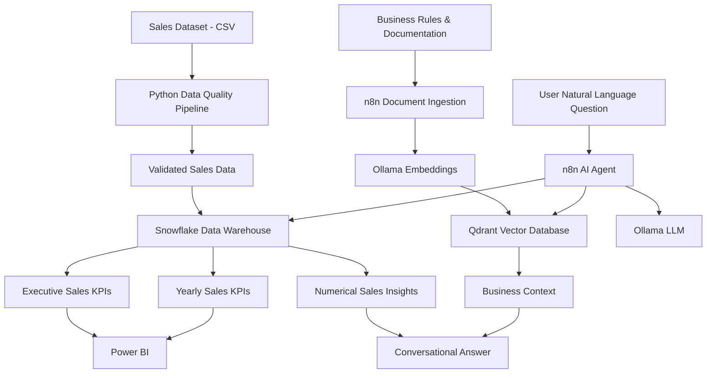

# sales-intelligence-rag-platform
# Sales Intelligence – AI-Powered Analytics & RAG Platform

An end-to-end Sales Intelligence platform combining data engineering, business intelligence, workflow automation and Retrieval-Augmented Generation (RAG) to transform raw sales data into actionable business insights.

The platform integrates **Python, Snowflake, Power BI, n8n, Ollama and Qdrant** to deliver reliable sales reporting and conversational business intelligence.

---

## Project Overview

Businesses often rely on disconnected spreadsheets, dashboards and reports to understand sales performance. Extracting meaningful insights requires manual analysis, repeated reporting tasks and knowledge of the underlying data.

This project addresses these challenges by building an integrated Sales Intelligence platform that:

- Automates sales data quality validation using Python.
- Stores and analyses structured sales data in Snowflake.
- Provides business reporting and visualisation through Power BI.
- Uses n8n to orchestrate AI-powered workflows.
- Implements RAG using Qdrant for retrieving business rules and reporting documentation.
- Uses a locally hosted LLM through Ollama to answer natural-language business questions.
- Separates exact numerical calculations from contextual document retrieval.

## Architecture



## Technology Stack

| Technology | Purpose |
|---|---|
| Python | Data cleaning, validation and quality checks |
| Pandas, NumPy | Data manipulation and analysis |
| Snowflake | Cloud data warehouse and SQL analytics |
| SQL | KPI calculations and analytical views |
| Power BI | Business intelligence and visualisation |
| n8n | Workflow automation and AI orchestration |
| Ollama | Local LLM and embedding model execution |
| Llama 3.2 | Natural-language question answering |
| Nomic Embed Text | Text embeddings |
| Qdrant | Vector database and semantic retrieval |
| Docker | Local service deployment and container management |
| Git & GitHub | Version control and project documentation |

## Dataset Overview

The project uses a sales dataset covering January 2023 to December 2025.

**Dataset characteristics:**

| Metric | Value |
|---|---:|
| Total records | 30,600 |
| Unique orders | 30,600 |
| Total units sold | 970,188 |
| Total revenue | $2,174,510,366.99 |
| Average selling price | $2,415.02 |
| Average discount | 38.11% |
| First sales date | 31 January 2023 |
| Last sales date | 31 December 2025 |

The dataset includes sales dimensions such as:

- Order date and order ID
- State and sales zone
- Product category and brand type
- Customer gender and age
- Base price and final price
- Discount percentage
- Units sold and revenue
- Sales events
- Competition intensity
- Inventory pressure

*The original sales dataset is not included in this public repository.*

## 1. Python – Data Quality Pipeline

Developed a Python-based data quality pipeline to validate and inspect the sales dataset before analytical processing.

**Validation checks performed:**

- Missing-value detection
- Duplicate row detection
- Duplicate order ID validation
- Invalid date detection
- Negative price validation
- Negative units sold validation
- Discount percentage validation
- Customer age range validation
- Discount formula consistency checks

**Data quality results:**

| Validation | Result |
|---|---:|
| Rows loaded | 30,600 |
| Missing values | 0 |
| Duplicate rows | 0 |
| Duplicate order IDs | 0 |
| Invalid dates | 0 |
| Negative prices | 0 |
| Negative units sold | 0 |
| Invalid discounts | 0 |
| Discount formula mismatches | 0 |

**Achievement:** Successfully validated all 30,600 records with zero outstanding data-quality issues in the final validation report.

## 2. Snowflake – Data Warehouse & SQL Analytics

Integrated the validated sales dataset into Snowflake and created a structured reporting environment.

**Database:** `SALES_INTELLIGENCE`

**Schemas:**
- RAW
- ANALYTICS
- REPORTING

**Warehouse:** `SALES_WH`

### Analytical views

**Executive Sales KPIs**

`SALES_INTELLIGENCE.REPORTING.EXECUTIVE_SALES_KPIS`

Provides overall sales performance metrics, including:
- Total records
- Unique orders
- Total units sold
- Total revenue
- Average selling price
- Average discount percentage
- First and last sales dates

**Yearly Sales KPIs**

`SALES_INTELLIGENCE.REPORTING.YEARLY_SALES_KPIS`

Provides year-level sales analysis:
- Unique orders by year
- Units sold by year
- Revenue by year
- Average selling price by year
- Average discount percentage by year

### Yearly revenue results

| Year | Total Revenue |
|---|---:|
| 2023 | $719,580,147.02 |
| 2024 | $721,002,284.45 |
| 2025 | $733,927,935.52 |

**Key finding:** 2025 recorded the highest annual revenue among the three years.

### Database security

Implemented a dedicated read-only Snowflake role for the AI reporting workflow.

- Role: `SALES_RAG_READONLY`
- User: `SALES_RAG_USER`
- Restricted access to authorised reporting views.
- Granted SELECT permissions rather than administrative access.

## 3. Power BI – Business Intelligence

Connected Power BI to Snowflake to access the reporting database and analytical views.

The integration provides a foundation for interactive sales reporting and business performance visualisation.

Reporting opportunities include:
- Category sales performance
- Monthly revenue trends
- State-level revenue rankings
- Yearly sales comparisons
- Executive KPI reporting

## 4. n8n – Workflow Automation

Implemented self-hosted n8n using Docker to orchestrate data ingestion and conversational AI workflows.

Created separate workflows for:

**Business Document Ingestion**
- Reads business reporting documentation.
- Extracts text from documents.
- Splits content into smaller chunks.
- Generates embeddings using Ollama.
- Stores embedded documents in Qdrant.

**Sales Intelligence RAG Q&A**
- Receives natural-language questions.
- Uses an AI Agent to understand user intent.
- Calls Snowflake for numerical sales analysis.
- Calls Qdrant for business definitions and reporting rules.
- Generates conversational answers using the local LLM.

## 5. RAG – Retrieval-Augmented Generation

Implemented a RAG architecture using Qdrant, Ollama and n8n.

**Embedding model:** `nomic-embed-text`

**Chat model:** `llama3.2`

**Vector database:** Qdrant

**Collection:** `sales_business_docs`

Business documentation is converted into vector embeddings and stored in Qdrant for semantic retrieval.

When users ask questions about reporting definitions, business rules or data sources, the AI Agent retrieves relevant documentation before generating an answer.

### Example questions

- What are the rules for reporting sales revenue and profit?
- What is the difference between revenue and profit?
- Which data source should be used for exact numerical reporting?
- Why is profit margin unavailable?

## 6. AI-Powered Conversational Sales Intelligence

Developed an AI Agent capable of answering business questions through natural language.

### Example questions successfully tested

| User question | Expected result |
|---|---|
| What is the total revenue? | $2,174,510,366.99 |
| How many units were sold? | 970,188 |
| How many unique orders were recorded in 2024? | 10,200 |
| What was the revenue in 2024? | $721,002,284.45 |
| Which year had the highest revenue? | 2025 |
| What is the first sales date? | 31 January 2023 |
| What is the last sales date? | 31 December 2025 |
| Can you calculate profit margin? | Explains that cost and profit data are unavailable |

### AI reliability and governance

Implemented instructions to ensure:

- Only authorised Snowflake views are queried.
- SQL operations are read-only.
- Year-specific questions use yearly analytical views.
- Revenue is never misrepresented as profit.
- Discount percentage is never treated as profit margin.
- Missing information is disclosed rather than invented.
- Qdrant is used for business context, while Snowflake is used for exact numerical calculations.

## Key Project Achievements

1. Built a data quality pipeline validating 30,600 sales records.
2. Achieved zero missing values, duplicates and final validation mismatches.
3. Developed Snowflake reporting views for executive and yearly analysis.
4. Integrated Snowflake with Power BI.
5. Deployed n8n and Qdrant using Docker.
6. Integrated a locally hosted LLM using Ollama.
7. Implemented semantic document retrieval using RAG.
8. Developed a conversational AI Agent connected to both Snowflake and Qdrant.
9. Implemented read-only database access and SQL restrictions.
10. Successfully tested overall sales reporting, yearly analysis and business-rule retrieval.

## Repository Structure

```text
sales-intelligence-rag-platform/
│
├── README.md
├── .gitignore
│
├── src/
│   ├── clean_data.py
│   ├── inspect_data.py
│   └── test_rounding.py
│
├── business-docs/
│   └── sales_reporting_rules.txt
│
├── reports/
│   ├── data_profile.txt
│   └── data_quality_report.txt
│
├── sql/
│
├── rag/
│
├── automation/
│
└── powerbi/
```

Additional SQL scripts, workflow exports, Power BI screenshots and architecture documentation can be added as the repository is expanded.

## Future Enhancements

- Monthly sales analytical views.
- Month-over-month revenue growth.
- Category and state-level conversational analysis.
- Automated scheduled reporting.
- Advanced forecasting and predictive analytics.
- More comprehensive Power BI dashboards.
- Automated document ingestion.
- Improved answer evaluation and monitoring.
- Deployment to a cloud environment.

## Project Limitations

- Profit and profit margin cannot currently be calculated because cost data is not available.
- The current RAG implementation uses local Ollama models.
- Numerical reporting is limited to the metrics available in the authorised Snowflake views.
- The current implementation is a portfolio and development project, not a production-certified enterprise deployment.

## Skills Demonstrated

**Data Analytics:** SQL, Python, Pandas, NumPy, KPI analysis, data quality validation.

**Data Engineering:** Snowflake, data warehousing, analytical views, structured data processing.

**Business Intelligence:** Power BI, executive reporting, sales performance analysis.

**AI & Automation:** RAG, LLMs, embeddings, Qdrant, Ollama, n8n, AI Agents.

**Infrastructure & Development:** Docker, Git, GitHub, workflow orchestration.

---

**Author:** Vijay Anbarasu

**GitHub:** [Vijay060-anb](https://github.com/Vijay060-anb)

**Project:** Sales Intelligence – AI-Powered Analytics & RAG Platform
